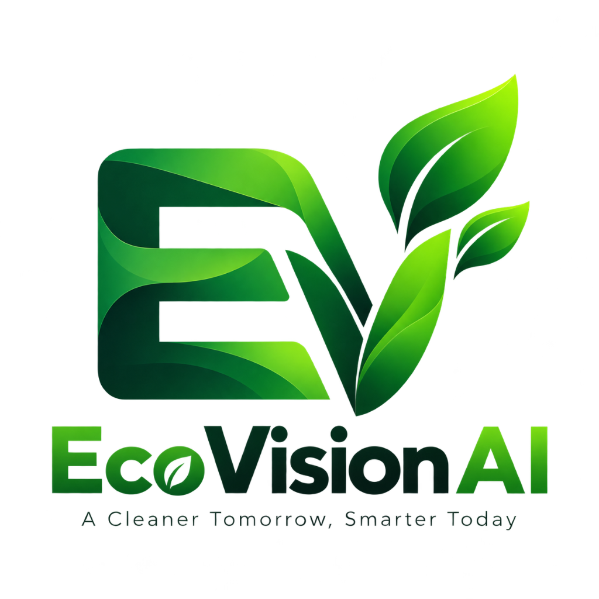

<p align="center">
  
</p>

# 🌱 EcoVision AI
**AI-Powered Environmental Monitoring & Waste Management Platform**

*A Cleaner Tomorrow, Smarter Today*

An academic, zero-cost, open-source environmental intelligence platform featuring a **Flutter Mobile Application** (Android & Desktop) with on-device waste classification, local SQLite persistence, citizen environmental reporting, and a **FastAPI Backend** with a dark glassmorphism web dashboard.

---

## 📱 Mobile Application (Flutter & Dart)

Located in [`mobile/`](file:///mobile).

### Key Features
- **🌿 GreenLeaf Splash & Onboarding**: Clean, modern animated brand splash screen leading into an interactive sustainability onboarding guide.
- **📊 GreenPulse Impact Dashboard**:
  - Live monthly stats: **42 kg CO₂ saved** (18% vs last month).
  - Snapshot meters: **128 kg CO₂** carbon footprint, **72 Good** eco score, **2 active quests**.
  - Category breakdown: Transport, Food & Organic, Shopping & Packaging, Campus & Hostel.
- **📸 AI Waste Scanner**:
  - Recognizes **Plastic (PET / PP Soft Wrappers)**, **Paper & Cardboard**, **Metal (Aluminium Cans)**, **Organic & Food Waste**, **Glass Bottles**, and **E-Waste & Batteries**.
  - Displays real-time model confidence (e.g. 94%), color-coded municipal bin destination (Blue / Green / Red Bin), and disposal steps.
  - **Manual Correction**: Allows correcting uncertain predictions with feedback.
- **📢 Citizen Environmental Reporting (EcoReport)**:
  - Submit local issues: Illegal Dumping, Plastic Overflow, Water Contamination, Open Burning, E-Waste Hazard.
  - Capture photo evidence, specify campus/local zone, and attach optional GPS coordinates.
  - Offline-first: saved to SQLite and synchronized when backend is reachable.
- **🏆 Rewards & Gamification**:
  - Level & XP progression (Lvl 3 • XP 1674).
  - Badges: *Sustainable New-bee*, *Bottle Buddy*, *CO2 Champion*.
  - Weekly challenge: *Brewed to Be Green: Zero-Waste Coffee Challenge*.
  - Exchange EcoPoints or donate to Campus Green Fund.
- **📚 EcoAdvisor**: Searchable waste segregation rules according to CPCB and Swachh Bharat guidelines.
- **🌐 Multilingual & Dual Theme**: Supports English and Marathi (मराठी) with Light & Dark glassmorphic modes.

### Run the Mobile App
```powershell
cd mobile

# Test on Windows Desktop
flutter run -d windows

# Test on Chrome Web
flutter run -d chrome

# Build or Run on Android Device / Emulator
flutter run -d android
flutter build apk --debug
```

To run tests:
```powershell
cd mobile
flutter test
```

---

## ⚡ Backend & Web Dashboard (FastAPI & Python)

The centralized backend provides API endpoints for synchronization, vector search, RAG, and an admin web portal.

### Quick Start
```powershell
# 1. Install Python dependencies
pip install -r requirements.txt

# 2. Launch FastAPI Server
python -m uvicorn app.main:app --host 127.0.0.1 --port 8000 --reload
# Or simply double click:
.\run.bat
```

### URLs
- **Web App Dashboard**: [http://127.0.0.1:8000/](http://127.0.0.1:8000/)
- **Interactive Swagger Docs**: [http://127.0.0.1:8000/docs](http://127.0.0.1:8000/docs)
- **Alternative ReDoc**: [http://127.0.0.1:8000/redoc](http://127.0.0.1:8000/redoc)
- **Health Check**: [http://127.0.0.1:8000/api/v1/health](http://127.0.0.1:8000/api/v1/health)

---

## 📂 Repository Structure

```
EcoVision AI/
├── app/                        ← FastAPI Python Backend
│   ├── __init__.py
│   ├── main.py                 ← Application entry point & static mounting
│   ├── config.py               ← Pydantic configuration & env loading
│   ├── models.py               ← Pydantic schemas (scans, reports, analysis)
│   ├── pipeline.py             ← Sentence-Transformers & FAISS embeddings
│   └── routes.py               ← /api/v1 REST routes
├── frontend/                   ← Web Dashboard
│   ├── index.html              ← Responsive dark glassmorphism SPA
│   └── static/
│       ├── css/style.css       ← Premium typography, animations & charts
│       └── js/app.js           ← Real-time interactions & API connectors
├── mobile/                     ← Flutter Cross-Platform Mobile App
│   ├── lib/
│   │   ├── core/               ← AppTheme (Light & Dark), constants
│   │   ├── models/             ← WasteScan, EnvironmentalReport, EcoAction, RewardItem
│   │   ├── providers/          ← AppState (Provider state management)
│   │   ├── services/           ← DatabaseService (SQLite / FFI), ClassifierService
│   │   ├── screens/            ← Splash, Onboarding, Home, Scanner, Report, My Reports, Rewards, EcoAdvisor, Profile
│   │   └── main.dart           ← Flutter entry point
│   ├── test/                   ← Automated widget & unit tests
│   └── pubspec.yaml            ← Material 3, provider, sqflite, fl_chart, http
├── data/                       ← Local data & SQLite databases
├── requirements.txt            ← Python backend dependencies
├── run.bat                     ← One-click server launcher
└── README.md
```
